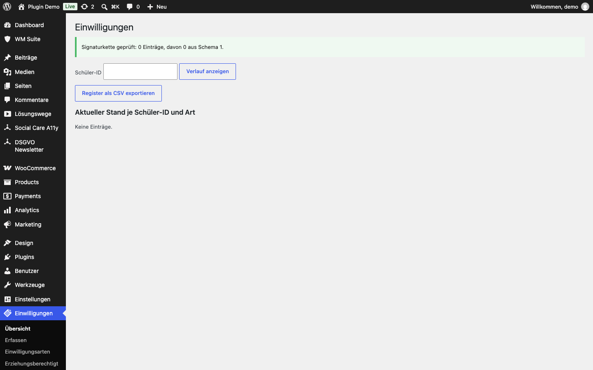
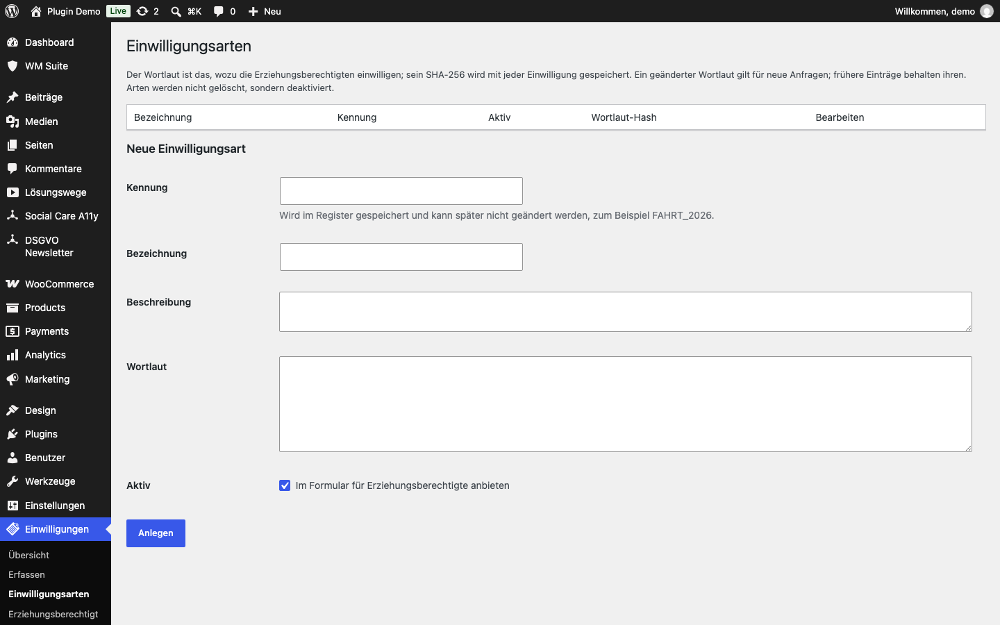
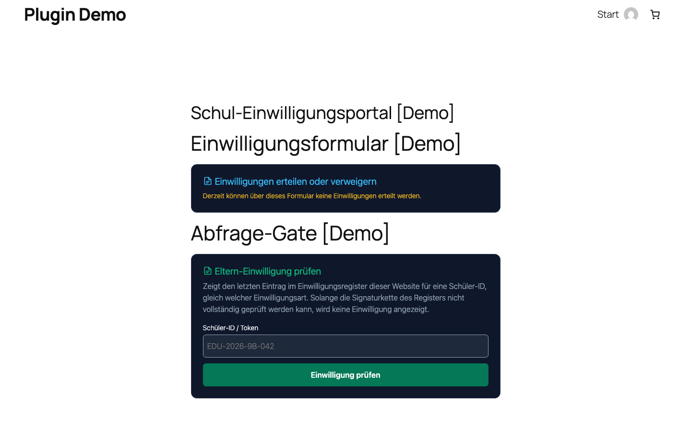

# WM Edu Privacy Portal (Deutsche Dokumentation)

<p align="center">
  <a href="README.md"></a>
  <a href="README.de.md"></a>
  <a href="README.es.md"></a>
</p>

> **Erfasst Eltern-Einwilligungen in einem hash-verketteten Register — Erziehungsberechtigte entscheiden über ein Formular, dessen Entscheidung per E-Mail bestätigt wird, die Schule arbeitet im Backend damit — und ersetzt deutsche Datumsangaben, Klassenbezeichnungen und übergebene Schülernamen durch Platzhalter**  
> **Plugin-Seite:** [https://arnoldwender.com/wordpress-plugins/wm-edu-privacy-portal/](https://arnoldwender.com/wordpress-plugins/wm-edu-privacy-portal/)  
> **Mit einem agentischen Workflow entwickelt:** entstanden mit KI-Coding-Agenten. Prüfen und testen Sie es wie jeden fremden Code, bevor Sie es produktiv einsetzen.  
> **Support & Haftung:** Kein Support (Zero Support) — reproduzierbare Bugs ausschließlich über [GitHub Issues](https://github.com/arnoldwender/wm-wp-edu-privacy-portal/issues) · kein privater Support · OHNE GEWÄHR („AS IS“) / keine Haftung ([SUPPORT.md](SUPPORT.md))

> Diese Datei beschreibt, was das Plugin ausliefert, gemessen am Code vom 2026-09-17. Bis zum 2026-09-17 schrieb nichts im Plugin Einwilligungen, die Abfrage und die Tokenizer-Routen waren öffentlich und es gab keine Verwaltungsseite; was an deren Stelle getreten ist, steht unten, und was offen bleibt, unter „Bekannte Einschränkungen“.

---

## Live-Vorschau

!WM Edu Privacy Portal Banner

| Einwilligungsregister | Einwilligungsarten | Frontend-Shortcodes |
|---|---|---|
|  |  |  |

---

## Was das Plugin leistet

1. **Einwilligungsarten.** Im Backend legt die Schule fest, worin eingewilligt werden kann: eine Kennung (wird mit jedem Eintrag gespeichert), eine Bezeichnung, eine Beschreibung, der genaue Wortlaut und ob neue Anfragen ihn anbieten dürfen. Der SHA-256 dieses Wortlauts ist der Scope-Hash jedes Eintrags, und jeder Wortlaut, den eine Art je hatte, bleibt unter seinem Hash archiviert: Der Text zu einem alten Eintrag lässt sich auch dann noch zeigen, wenn die Art inzwischen anders formuliert ist. Arten werden nicht gelöscht, nur deaktiviert.
2. **Zuordnung der Erziehungsberechtigten.** Paare aus der Schüler-ID, die die Schule vergibt, und einer E-Mail-Adresse, im Backend zeilenweise importiert. Gespeichert wird nur ein HMAC der kleingeschriebenen Adresse — genug, um eine eingetippte Adresse zu prüfen, zu wenig, um eine auszulesen —, deshalb zeigt die Liste je Schüler-ID nur die Anzahl der Adressen.
3. **Einwilligungsformular.** `[wm_edu_consent_form]` fragt Schüler-ID, E-Mail-Adresse, je aktiver Art eine Entscheidung (erteilen oder verweigern) und die Bestätigung, den Wortlaut gelesen zu haben. Die Antwort ist dieselbe, ob das Paar hinterlegt ist oder nicht; nur ein hinterlegtes Paar erhält eine E-Mail mit einem einmaligen Link, der nach der eingestellten Zahl Stunden abläuft (Vorgabe 48). Die Seite des Links zeigt Entscheidungen und Wortlaut und erfasst sie erst beim Absenden mit gesetztem Häkchen, nie beim Aufruf. Die Bestätigungsmail enthält einen Widerrufslink, der `REVOKED` erfasst — ebenfalls erst beim Absenden. Anfragen werden je IP und je Adresse pro Stunde gezählt, ein verstecktes Feld fängt Programme ab, die jedes Eingabefeld ausfüllen, und Seiten mit Token werden ohne Caching und mit `Referrer-Policy: no-referrer` ausgeliefert.
4. **Einwilligungsregister.** `{prefix}wm_edu_parent_consents`, Schema 3: Schüler-Token, Eltern-E-Mail, Art, Scope-Hash, Status `GRANTED` / `REVOKED` / `DENIED` ohne Vorgabewert, HMAC der schreibenden IP, Kennung des Signaturschlüssels, Herkunft des Eintrags (`source`, `actor_id`, `note`), vorheriger Hash, Signatur, Zeit. Jeder Eintrag hält eine MySQL-Sperre für diese Datenbank und Tabelle, hängt sich an die aufgezeichnete Kettenspitze — eine signierte Option, nicht die letzte Tabellenzeile — und schreibt Zeile und neue Spitze in einer Transaktion; wer die Sperre nicht bekommt, schreibt nicht. `verify_chain()` prüft alle Verknüpfungen und Signaturen, unterscheidet einen geänderten Schlüssel von einer bearbeiteten Zeile, prüft Zeilen aus Schema 1 und 2 in ihrem eigenen Format und meldet ein Register, das nicht an der aufgezeichneten Spitze endet.
5. **Verwaltungsseite.** Hinter der eigenen Berechtigung `manage_edu_consents` (bei der Installation an Administratoren vergeben): aktueller Stand je Schüler-ID und Art, Verlauf einer Schüler-ID, Nacherfassung einer Einwilligung mit Begründung, Widerruf eines vorliegenden Eintrags, die Einwilligungsarten, die Zuordnungen und ein CSV-Export des Registers; die Einstellungen verlangen `manage_options`. Jede Seite beginnt mit dem Zustand der Signaturkette. Einträge aus dem Backend werden mit dem handelnden Benutzerkonto und der Begründung signiert.
6. **Abfrage im Portal.** `[wm_edu_consent_gate]` zeigt „GÜLTIGE EINWILLIGUNG“, „REGISTER NICHT PRÜFBAR“, solange die Kette nicht geprüft werden kann, und sonst „KEIN NACHWEIS“ — für den letzten Eintrag jeder Art oder der im Attribut `type` genannten. Sie steht Benutzern mit der Berechtigung oder einer in den Einstellungen genannten Rolle offen und prüft für angemeldete Benutzer einen Nonce.
7. **Tokenizer.** Ersetzt der Reihe nach jeden Namen aus `known_students` (ganzes Wort, ohne Groß-/Kleinschreibung, längster Name zuerst) durch den übergebenen Token oder `[[STUDENT_<8 Hex>]]`, jedes deutsche Datum (`15.03.2012`, `15. März 2012` — jedes Datum, nicht nur Geburtsdaten) durch `[[DOB_<8 Hex>]]` und jede Angabe `Klasse 9b` / `Kl. 7c` durch `[[CLASS_<6 Hex>]]`. Der Hex-Teil ist ein HMAC-SHA256 mit einem nur dafür aus `wp_salt( 'auth' )` abgeleiteten Schlüssel; `detokenize()` setzt die Originale in einem Durchgang zurück.
8. **Zugänge zum Tokenizer.** `POST /wp-json/wm-edu/v1/tokenize` und `/detokenize` verlangen eine Anmeldung und eine Berechtigung, die standardmäßig `edit_posts` ist und über `wm_edu_tokenizer_capability` geändert werden kann: ohne Anmeldung 401, ohne Berechtigung 403. `wp edu tokenize "<Text>"` ersetzt Datumsangaben und Klassen auf dem Server, der Demo-Shortcode `[wm_edu_pii_sanitizer]` verlangt dieselbe Berechtigung.
9. **Aufbewahrung, Befehle, Hub.** Ein täglicher Termin löscht die Daten nie bestätigter Anfragen, sobald die eingestellte Frist nach ihrem Ablauf vergangen ist, löscht abgeschlossene Anfragen und gibt unterbrochene wieder frei; erfasste Einwilligungen sind Nachweise und werden im laufenden Betrieb nie gelöscht. `wp edu status` zeigt den Zustand des Registers samt aufgezeichneter Spitze und endet mit Fehler, wenn die Kette ungültig ist; `wp edu cleanup` wendet die Frist von Hand an. Der WM-Suite-Hub-Spoke meldet Health, Zeilenzahlen, aktive Arten und offene Anfragen.
10. **Ökosystem-Brücken und Erweiterbarkeit.** Registriert die WordPress-6.5+-Block-Bindings-Quelle `wm-edu/status` sowie das GenerateBlocks-2.x-Dynamic-Tag `{{wm_edu_status}}`, löst beim Start `wm_edu_ready` aus und stellt die Filter `wm_edu_status_value`, `wm_edu_export_csv_output` und `wm_edu_export_csv_stream` bereit.

### Nicht enthalten

Kein PDF- oder GoBD-Prüfbericht; keine Erinnerungsmails und kein Massenimport von Einwilligungen; kein Löschen erfasster Einwilligungen im laufenden Betrieb (und bei der Deinstallation standardmäßig erhalten, sofern Administratoren `wm_edu_delete_data_on_uninstall` nicht ausdrücklich aktivieren); keine Erkennung von Schülernamen ohne übergebene Liste, von Adressen, E-Mail-Adressen, Telefonnummern, Noten oder anderen personenbezogenen Daten; keine externen Anfragen und kein Frontend-Skript; keine Bewertung nach irgendeinem Gesetz.

---

## Schnellstart

1. Plugin installieren und aktivieren (WordPress 6.4+, PHP 8.1+). Die Aktivierung legt die Tabellen an und gibt Administratoren die Berechtigung `manage_edu_consents`.
2. Unter **Einwilligungen → Einwilligungsarten** anlegen, worin eingewilligt werden kann: Kennung (etwa `FAHRT_2026`), Bezeichnung und genauer Wortlaut.
3. Unter **Einwilligungen → Erziehungsberechtigte** die Paare aus Schüler-ID und Adresse importieren, eines je Zeile (`EDU-2026-9B-042;mutter@beispiel.de`).
4. `[wm_edu_consent_form]` auf eine Seite setzen und deren Adresse an die Familien geben. Die Entscheidung steht nach der Bestätigung im Register; die Bestätigungsmail enthält den Widerrufslink.
5. Das Register unter **Einwilligungen → Übersicht** lesen, als CSV exportieren, eine Papier-Einwilligung unter **Erfassen** nachtragen und eine Schüler-ID auf einer Seite mit `[wm_edu_consent_gate]` oder per `wp edu status` nachschlagen.

Klassen, Tabellen, Routen, Befehle und bekannte Einschränkungen: **[README.md](README.md)** (Referenz) und **[DEVELOPERS.md](DEVELOPERS.md)**.

```bash
php tests/test-suite.php        # Standalone-Suite auf SQLite (pdo_sqlite), ohne WordPress
bash tests/run-mutations.sh     # jede Korrektur einmal rückgängig gemacht; die Suite muss jedes Mal scheitern
```

---

## Bekannte Einschränkungen

- Die Zuordnung ist die einzige Prüfung, wer für eine Schüler-ID antworten darf; der Link geht an die hinterlegte Adresse, bestätigen kann also nur deren Inhaber. Ohne Zuordnungen kommt keine Einwilligung zustande.
- Die Antwort ist für hinterlegte und nicht hinterlegte Paare gleich, die Antwortzeit nicht: ein hinterlegtes Paar kostet einen Mailversand innerhalb der Anfrage.
- Eine Datenbank ohne benannte MySQL-Sperren nimmt keine Einwilligung an: die SQLite-Integration beantwortet `GET_LOCK()` mit der Zeichenkette `1=1` (Stub im Quelltext, gelesen am 2026-09-17), also antwortet das Plugin mit 503.
- Die aufgezeichnete Spitze liegt in `wp_options`: Wer Zeilen löschen kann, kann auch sie löschen; danach meldet das Register eine fehlende Spitze und bleibt ungeprüft — Schreiben funktioniert weiter, und kein späterer Eintrag erklärt das Register wieder für gültig.
- Ein geänderter Auth-Salt lässt die Zeilen einen anderen Schlüssel melden, die Abfrage nichts anzeigen und die Zuordnungen nicht mehr greifen.
- Das Register ist rein anhängend und übersteht standardmäßig auch die Deinstallation, zusammen mit Einstellungen, Spitze, Arten, Wortlaut-Archiv und Zuordnungen; erst nach ausdrücklicher Aktivierung von `wm_edu_delete_data_on_uninstall` in den Einstellungen entfernt `uninstall.php` Optionen, Berechtigung und Tabellen.
- Eine Bestätigungsmail, die die Website nicht versenden kann, löscht die Anfrage; die Erziehungsberechtigten sehen die übliche Antwort und müssen erneut absenden.
- Das Datumsmuster ersetzt jedes deutsche Datum; Namen nur mit übergebener Liste, und zwei gleiche Namen ergeben denselben Token.

---

## Datenschutz und Reichweite

- **Keine externen Anfragen:** das Plugin sendet nichts nach außen außer den E-Mails, die eine Eingabe der Erziehungsberechtigten auslöst, über den Mailversand der Website.
- **Personenbezogene Daten:** das Register enthält Schüler-IDs, Eltern-E-Mail-Adressen, mit Schlüssel berechnete IP-Hashes (HMAC, keine Verschlüsselung) und die Begründung händischer Einträge; es wird nur angehängt. Eine nie bestätigte Anfrage enthält Schüler-ID und Adresse bis zum Ablauf der Aufbewahrungsfrist, eine bestätigte keines von beidem. Die Zuordnungen enthalten Schüler-IDs und Adress-HMACs.
- **Reichweite:** das Plugin trifft keine Bewertung nach DSGVO (Art. 8 oder sonst), den Schulgesetzen der Länder, FERPA oder COPPA und sagt nichts darüber, ob eine erfasste Einwilligung wirksam ist. Drei Datenarten durch Platzhalter zu ersetzen ist keine vollständige Anonymisierung.

---

## Lizenz

Vertrieben unter der **GNU General Public License v2 oder neuer** (`GPL-2.0-or-later`).  
Copyright (C) 2026 Arnold Wender.  
