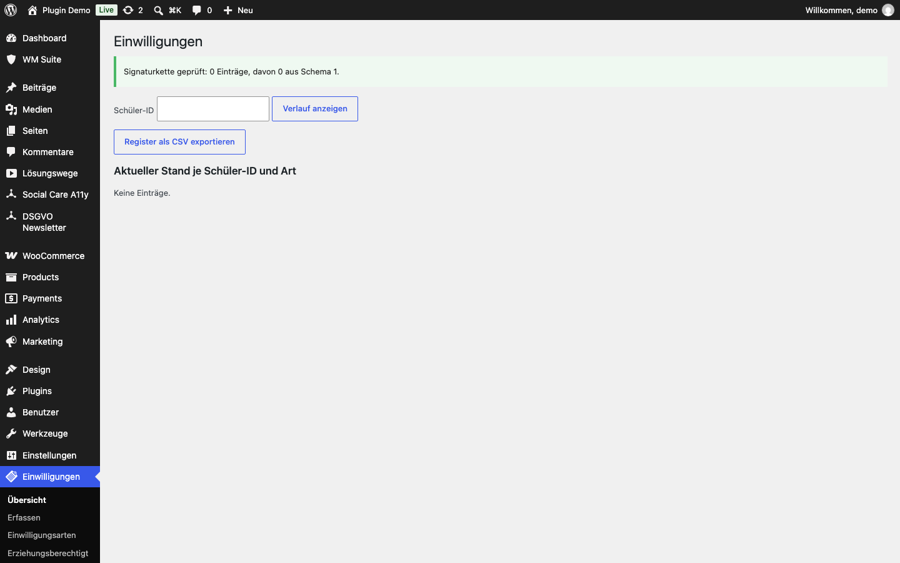
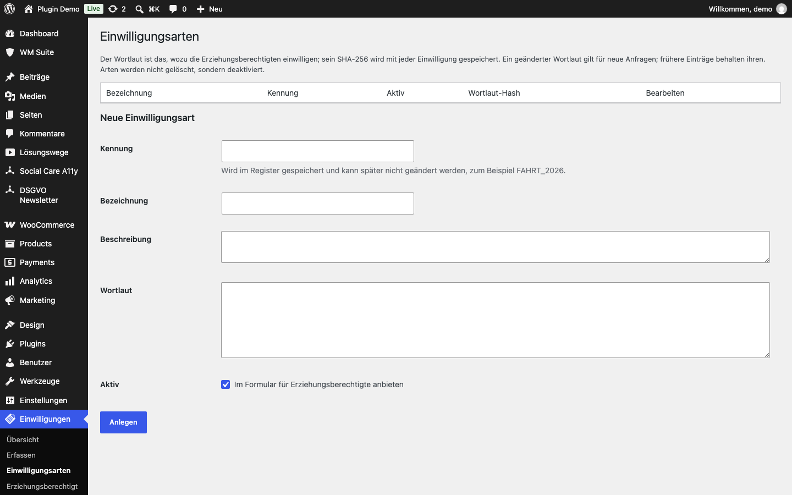
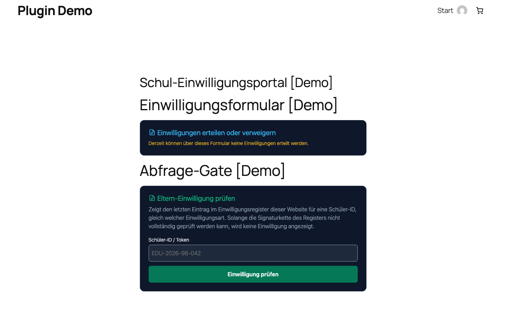

# WM Edu Privacy Portal (Documentación en Español)

<p align="center">
  <a href="README.md"></a>
  <a href="README.de.md"></a>
  <a href="README.es.md"></a>
</p>

> **Registra el consentimiento de madres, padres o tutores en un registro encadenado por hashes — ellos deciden en un formulario cuya decisión se confirma por correo, el centro trabaja con ello en una pantalla de administración — y sustituye fechas alemanas, grupos escolares y nombres de alumnos que se le pasen por marcadores**  
> **Página del plugin:** [https://arnoldwender.com/es/plugins-wordpress/wm-edu-privacy-portal/](https://arnoldwender.com/es/plugins-wordpress/wm-edu-privacy-portal/)  
> **Desarrollado con un agentic workflow:** creado con agentes de programación de IA. Revísalo y pruébalo como cualquier código de terceros antes de usarlo en producción.  
> **Soporte y responsabilidad:** Cero soporte (Zero Support) — errores reproducibles únicamente en [GitHub Issues](https://github.com/arnoldwender/wm-wp-edu-privacy-portal/issues) · sin soporte privado · TAL CUAL («AS IS») / sin responsabilidad ([SUPPORT.md](SUPPORT.md))

> Este archivo describe lo que el plugin entrega, medido contra el código el 2026-09-17. Hasta el 2026-09-17 nada escribía consentimientos, la consulta y las rutas de tokenización eran públicas y no había pantalla de administración; abajo está lo que ocupó su lugar, y en «Limitaciones conocidas», lo que sigue abierto.

---

## Capturas en vivo

!Banner de WM Edu Privacy Portal

| Registro de consentimientos | Tipos de consentimiento | Shortcodes en frontend |
|---|---|---|
|  |  |  |

---

## Qué hace el plugin

1. **Tipos de consentimiento.** En la administración el centro define a qué se consiente: una clave (se guarda con cada entrada), una etiqueta, una descripción, el texto exacto y si las nuevas peticiones pueden ofrecerlo. El SHA-256 de ese texto es el hash de alcance de cada entrada, y cada texto que el tipo tuvo queda archivado bajo su hash: el texto de una entrada antigua se puede mostrar aunque el tipo se haya reescrito. Los tipos no se borran, solo se desactivan.
2. **Registro de tutores.** Pares del identificador de alumno que da el centro y un correo, importados en la administración, uno por línea. Solo se guarda un HMAC del correo en minúsculas — suficiente para comparar el que se teclea, insuficiente para leerlo —, así que la lista muestra cuántas direcciones tiene cada identificador, no cuáles.
3. **Formulario de consentimiento.** `[wm_edu_consent_form]` pide el identificador del alumno, el correo del tutor, una decisión por cada tipo activo (conceder o denegar) y la confirmación de haber leído el texto. La respuesta es la misma exista o no el par; solo un par registrado recibe un correo con un enlace de un solo uso que caduca a las horas configuradas (48 por defecto). La página del enlace muestra las decisiones y el texto y las registra únicamente al enviar el formulario con la casilla marcada, nunca al abrirlo. El correo de confirmación lleva un enlace de revocación que registra `REVOKED`, también solo al enviar. Las peticiones se cuentan por IP y por correo cada hora, un campo oculto atrapa a los programas que rellenan todo, y las páginas con token se sirven sin caché y con `Referrer-Policy: no-referrer`.
4. **Registro de consentimientos.** `{prefix}wm_edu_parent_consents`, esquema 3: token del alumno, correo, tipo, hash de alcance, estado `GRANTED` / `REVOKED` / `DENIED` sin valor por defecto, HMAC de la IP que escribe, huella de la clave de firma, procedencia de la entrada (`source`, `actor_id`, `note`), hash previo, firma y hora. Cada escritura toma un bloqueo con nombre de MySQL para esta base y tabla, enlaza con la punta registrada de la cadena — una opción firmada, no la última fila — y escribe fila y punta nueva en una transacción; quien no obtiene el bloqueo no escribe. `verify_chain()` recalcula enlaces y firmas, distingue una clave cambiada de una fila editada, verifica las filas de los esquemas 1 y 2 en su propio formato y avisa si el registro no termina en la punta registrada.
5. **Pantalla de administración.** Tras la capacidad propia `manage_edu_consents` (concedida a los administradores al instalar): estado vigente por alumno y tipo, historial de un alumno, alta manual con su motivo, revocación de una entrada existente, los tipos, el registro de tutores y la exportación CSV del registro; los ajustes exigen `manage_options`. Cada página abre con el estado de la cadena de firmas. Las entradas hechas en la administración se firman con el usuario que actúa y el motivo.
6. **Consulta en el portal.** `[wm_edu_consent_gate]` muestra «GÜLTIGE EINWILLIGUNG», «REGISTER NICHT PRÜFBAR» mientras la cadena no verifica y «KEIN NACHWEIS» en los demás casos, para la última entrada de cualquier tipo o del indicado en el atributo `type`. Está abierta a quien tenga la capacidad o un rol elegido en los ajustes, y comprueba un nonce para usuarios identificados.
7. **Tokenizador.** Sustituye cada nombre de `known_students` (palabra completa, sin distinguir mayúsculas, el más largo primero) por el token indicado o `[[STUDENT_<8 hex>]]`, cada fecha alemana (`15.03.2012`, `15. März 2012`; cualquier fecha, no solo de nacimiento) por `[[DOB_<8 hex>]]` y cada `Klasse 9b` / `Kl. 7c` por `[[CLASS_<6 hex>]]`. La parte hex es un HMAC-SHA256 con una clave derivada de `wp_salt( 'auth' )` solo para eso; `detokenize()` repone los originales de una pasada.
8. **Entradas del tokenizador.** `POST /wp-json/wm-edu/v1/tokenize` y `/detokenize` exigen sesión y una capacidad que por defecto es `edit_posts` y se puede cambiar con el filtro `wm_edu_tokenizer_capability`: sin sesión responden 401, sin la capacidad 403. `wp edu tokenize "<texto>"` sustituye fechas y grupos en el servidor, y el shortcode de demostración `[wm_edu_pii_sanitizer]` pide la misma capacidad.
9. **Retención, comandos y hub.** Un evento diario borra los datos de las peticiones que nunca se confirmaron cuando pasa el plazo configurado desde su caducidad, borra las peticiones cerradas y libera las interrumpidas; los consentimientos registrados son evidencia y no se borran durante la operación. `wp edu status` muestra el estado del registro y su punta registrada y termina con error si la cadena no verifica; `wp edu cleanup` aplica la retención a mano. El spoke del WM Suite Hub informa de salud, número de filas, tipos activos y peticiones pendientes.
10. **Puentes de ecosistema y extensibilidad.** Registra la fuente de Block Bindings `wm-edu/status` (WordPress 6.5+) y la etiqueta dinámica `{{wm_edu_status}}` (GenerateBlocks 2.x), emite la acción `wm_edu_ready` y ofrece los filtros `wm_edu_status_value`, `wm_edu_export_csv_output` y `wm_edu_export_csv_stream`.

### No incluido

Sin informes PDF ni GoBD; sin correos recordatorios ni importación masiva de consentimientos; sin borrado de consentimientos registrados durante el funcionamiento (y conservados por defecto al desinstalar salvo activación expresa de `wm_edu_delete_data_on_uninstall`); sin detección de nombres de alumnos sin lista, ni de direcciones, correos, teléfonos, notas u otros datos personales; sin peticiones externas ni script de frontend; sin evaluación conforme a ninguna ley.

---

## Inicio rápido

1. Instala y activa el plugin (WordPress 6.4+, PHP 8.1+). La activación crea las tablas y da a los administradores la capacidad `manage_edu_consents`.
2. En **Einwilligungen → Einwilligungsarten**, crea a qué se puede consentir: clave (por ejemplo `FAHRT_2026`), etiqueta y texto exacto.
3. En **Einwilligungen → Erziehungsberechtigte**, importa los pares de identificador y correo, uno por línea (`EDU-2026-9B-042;mutter@beispiel.de`).
4. Pon `[wm_edu_consent_form]` en una página y da su dirección a las familias. La decisión entra en el registro al confirmarse; el correo de confirmación lleva el enlace de revocación.
5. Lee el registro en **Einwilligungen → Übersicht**, expórtalo a CSV, da de alta un consentimiento en papel en **Erfassen** y consulta un alumno con `[wm_edu_consent_gate]` o con `wp edu status`.

Clases, tablas, rutas, comandos y limitaciones: **[README.md](README.md)** (referencia) y **[DEVELOPERS.md](DEVELOPERS.md)**.

```bash
php tests/test-suite.php        # suite standalone sobre SQLite (pdo_sqlite), sin WordPress
bash tests/run-mutations.sh     # deshace cada corrección una vez; la suite debe fallar cada vez
```

---

## Limitaciones conocidas

- El registro de tutores es la única comprobación de quién puede responder por un alumno; el enlace va a la dirección registrada, así que solo su titular puede confirmar. Sin registro no se recoge ningún consentimiento.
- La respuesta es idéntica para un par registrado y uno que no lo está; el tiempo de respuesta no: el registrado cuesta un envío de correo dentro de la petición.
- Una base de datos sin bloqueos con nombre de MySQL no acepta ninguna escritura: la integración SQLite responde a `GET_LOCK()` con la cadena `1=1` (un stub en su código, leído el 2026-09-17), así que el plugin responde 503.
- La punta registrada vive en `wp_options`: quien pueda borrar filas puede borrarla; entonces el registro informa de que falta y queda sin verificar — se sigue pudiendo escribir y ninguna escritura posterior lo da por bueno.
- Cambiar el salt de autenticación hace que las filas declaren otra clave, que la consulta no muestre nada y que el registro de tutores deje de coincidir.
- El registro solo añade y sobrevive por defecto a la desinstalación, igual que los ajustes, la punta, los tipos, el archivo de textos y los tutores; solo cuando un administrador activa expresamente `wm_edu_delete_data_on_uninstall` en los ajustes borra `uninstall.php` las opciones, la capacidad y las tablas.
- Un correo de confirmación que el sitio no puede enviar borra la petición; el tutor ve la respuesta habitual y tiene que volver a enviarla.
- El patrón de fechas sustituye cualquier fecha alemana; los nombres solo con lista, y dos alumnos con el mismo nombre comparten token.

---

## Datos personales y alcance

- **Sin peticiones externas:** el plugin no envía nada fuera salvo los correos que provoca el propio envío del tutor, por el sistema de correo del sitio.
- **Datos personales:** el registro contiene identificadores de alumnos, correos, hashes de IP con clave (HMAC, no cifrado) y el motivo de las altas manuales; solo se añade. Una petición nunca confirmada guarda identificador y correo hasta que la retención los borra; una confirmada no guarda ninguno de los dos. El registro de tutores guarda identificadores y HMAC de correos.
- **Alcance:** el plugin no hace ninguna evaluación conforme al RGPD (Art. 8 u otros), las leyes escolares alemanas, FERPA ni COPPA, ni se pronuncia sobre si un consentimiento registrado es válido. Sustituir tres tipos de datos por marcadores no es una anonimización completa.

---

## Licencia

Distribuido bajo la **GNU General Public License v2 o posterior** (`GPL-2.0-or-later`).  
Copyright (C) 2026 Arnold Wender.  
