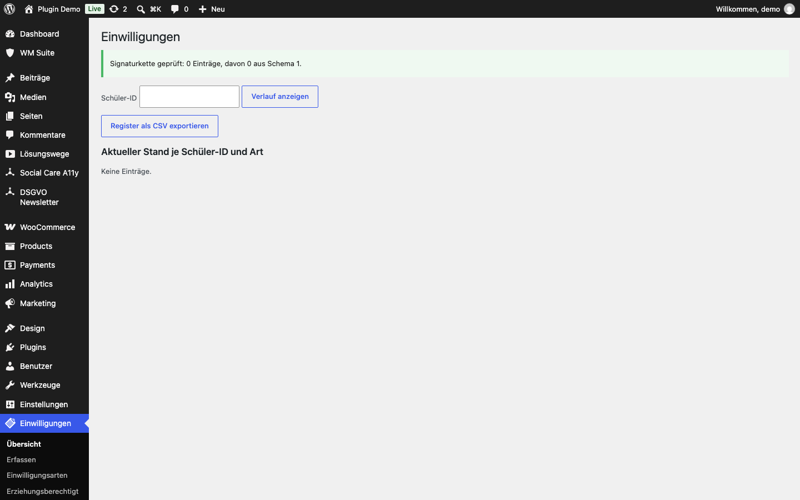
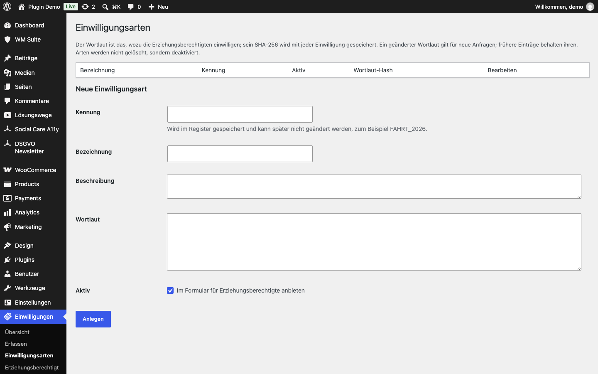
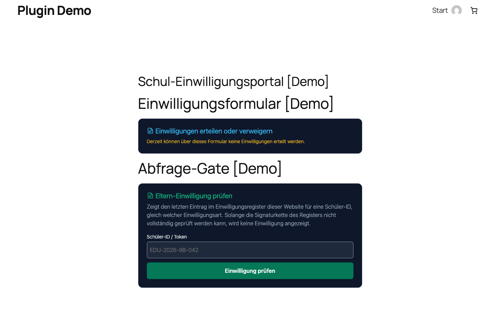

# WM Edu Privacy Portal

<p align="center">
  <a href="README.md"></a>
  <a href="README.de.md"></a>
  <a href="README.es.md"></a>
  <a href="#translated-documentation"></a>
</p>

<p align="center">
  <a href="https://wordpress.org"></a>
  <a href="https://php.net"></a>
  
  <a href="https://www.gnu.org/licenses/gpl-2.0.html"></a>
</p>

> **Records parental consent in a hash-chained register — guardians decide through a form whose decision is confirmed by e-mail, the school works with it on an admin screen — and replaces German dates, class identifiers and caller-supplied pupil names with placeholders**  
> **Plugin page:** [https://arnoldwender.com/wordpress-plugins/wm-edu-privacy-portal/](https://arnoldwender.com/wordpress-plugins/wm-edu-privacy-portal/)  
> **Built with an agentic workflow:** developed with AI coding agents. Review and test it like any third-party code before you use it in production.  
> **Support & Liability:** Zero support — reproducible bugs on [GitHub Issues](https://github.com/arnoldwender/wm-wp-edu-privacy-portal/issues) only · no private support · AS IS / no liability ([SUPPORT.md](SUPPORT.md))

> This README describes what the plugin ships, measured against the code on 2026-09-17. Until 2026-09-17 the consent table had no writer, the lookup and the tokenizer routes were public, and there was no admin screen; the sections below describe what replaced that, and "Known issues" says what is still open.

---

## Images

!WM Edu Privacy Portal banner

The banner above and the live WordPress screenshots below live in `.wordpress-org/`; the old marketing mockups were archived outside the repository on 2026-11-20 (release 1.2.0).

| Consent Register | Consent Types | Frontend Shortcodes |
|---|---|---|
|  |  |  |

---

## What the plugin does

1. **Consent types.** On the admin screen a school defines what can be consented to: a slug (stored with every entry), a label, a description, the exact text and whether new requests may name it. The SHA-256 of that text is the scope hash kept with every entry, and every text the type ever carried is archived under its hash, so the wording behind an old entry can still be shown after the text was edited. Types are never deleted, only deactivated.
2. **Guardian registry.** Pairs of the pupil ID the school hands out and a guardian's e-mail address, imported on the admin screen (one pair per line). Only an HMAC of the lower-cased address is stored — enough to compare a typed address, not enough to read one back — so the list shows how many addresses a pupil ID has, not which.
3. **Consent form.** `[wm_edu_consent_form]` asks for the pupil ID, the guardian's address, a decision per active type (grant or deny) and a confirmation that the wording was read. The answer is the same whether or not the pair is registered; only a registered pair receives an e-mail with a one-time link that expires after the configured hours (48 by default). The link's page shows the decisions and the wording and records them only on `POST` with the read box ticked, never on the `GET` that opens it. The receipt mail carries a revocation link that records `REVOKED`, again only on `POST`. Submissions are counted per client IP and per address per hour, a hidden field catches programs that fill every input, and the pages that carry a token are sent with no-cache headers and `Referrer-Policy: no-referrer`.
4. **Consent register.** `{prefix}wm_edu_parent_consents`, schema 3: pupil token, guardian e-mail, consent type, scope hash, status `GRANTED` / `REVOKED` / `DENIED` without a default, an HMAC of the writer's IP, a fingerprint of the signing key, where the entry came from (`source`, `actor_id`, `note`), previous hash, signature, time. Every append holds a MySQL named lock for this database and table, links to the recorded chain tip — a signed option, not the last row in the table — and writes the row and the new tip in one transaction; a lock that cannot be taken refuses the write instead of forking the chain. `verify_chain()` recomputes every link and signature, tells a changed site key from an edited row, verifies schema-1 and schema-2 rows in their own format, and reports a register that does not end at the recorded tip.
5. **Admin screen.** Behind the plugin's own capability `manage_edu_consents` (granted to administrators on install): the current state per pupil ID and type, the history of one pupil, a consent recorded by hand with the reason for it, the revocation of an entry on file, the consent types, the guardian registry and a CSV export of the whole register; the settings page needs `manage_options`. Every page opens with the state of the signature chain. Manual entries and revocations are signed with the acting user and the reason.
6. **Consent lookup.** `[wm_edu_consent_gate]` prints "GÜLTIGE EINWILLIGUNG" for a granted consent, "REGISTER NICHT PRÜFBAR" while the chain does not verify and "KEIN NACHWEIS" otherwise, for the newest entry of any type or of the type named in the `type` attribute. It is shown to users with the capability or with a role named in the settings and verifies a nonce for logged-in users.
7. **Tokenizer.** `WM_Edu_PII_Tokenizer::tokenize( $text, $known_students = [] )` replaces, in this order: every name in `known_students` (whole word, case-insensitive, longest name first, so `Max` never splits `Max Müller`) by the token given for it or by `[[STUDENT_<8 hex>]]`; every German date written `15.03.2012` or `15. März 2012` (any date, not only dates of birth) by `[[DOB_<8 hex>]]`; every `Klasse 9b` / `Kl. 7c` by `[[CLASS_<6 hex>]]`. The hex part is an HMAC-SHA256 of the original under a key derived from `wp_salt( 'auth' )` for the tokenizer alone. `detokenize( $text, $token_map )` puts the originals back in one pass.
8. **Tokenizer front doors.** `POST /wp-json/wm-edu/v1/tokenize` (`text`, `known_students`) and `/detokenize` (`text`, `token_map`) need an authenticated user with a capability that defaults to `edit_posts` and is filterable through `wm_edu_tokenizer_capability`; without a login they answer 401, without the capability 403. `wp edu tokenize "<text>"` replaces dates and class identifiers on the server. The demo shortcode `[wm_edu_pii_sanitizer]` is the same tokenizer on a typed text and asks for the same capability.
9. **Retention, commands and hub.** A daily event deletes the data of requests that were never confirmed once the configured period after their expiry has passed, deletes closed requests and releases interrupted ones; recorded consents are evidence and are never deleted during operation. `wp edu status` prints the register's state and the recorded tip and exits 1 when the chain does not verify; `wp edu cleanup` applies the retention by hand. The WM Suite Hub spoke reports health, the row counts, the active types and the requests still pending.
10. **Ecosystem bridges and extensibility.** Registers the WordPress 6.5+ Block Bindings source `wm-edu/status` and the GenerateBlocks 2.x Dynamic Tag `{{wm_edu_status}}` for displaying the register's verification state (or a pupil's state when authorised), fires `wm_edu_ready` on `init`, and filters status and CSV export streams via `wm_edu_status_value`, `wm_edu_export_csv_output` and `wm_edu_export_csv_stream`.

### Not shipped

No PDF or GoBD audit export; no reminder mails and no bulk import of consents; no deletion of recorded consents during normal operation (and preserved on uninstall by default unless the administrator explicitly opts into `wm_edu_delete_data_on_uninstall`); no detection of pupil names without a caller-supplied list, nor of addresses, e-mail addresses, phone numbers, grades or other personal data; no external requests and no frontend script; no assessment under any law.

---

## Quick start

1. Install and activate the plugin (WordPress 6.4+, PHP 8.1+). Activation creates the tables and gives administrators the capability `manage_edu_consents`.
2. In **Einwilligungen → Einwilligungsarten**, add what can be consented to: a slug such as `FAHRT_2026`, a label and the exact wording.
3. In **Einwilligungen → Erziehungsberechtigte**, import the pairs of pupil ID and guardian address, one per line (`EDU-2026-9B-042;mutter@beispiel.de`).
4. Put `[wm_edu_consent_form]` on a page and give its address to the families. A guardian decides, confirms the e-mailed link, and the decision is in the register; the receipt mail carries the revocation link.
5. Read the register under **Einwilligungen → Übersicht**, export it as CSV, record a paper consent under **Erfassen**, and look a pupil up on a page with `[wm_edu_consent_gate]` or with `wp edu status` on the server.

---

## Developers

Classes, tables, routes, commands, hooks and the hub adapter: **[DEVELOPERS.md](DEVELOPERS.md)**.

```bash
php tests/test-suite.php        # standalone suite on SQLite (pdo_sqlite), no WordPress needed
bash tests/run-mutations.sh     # each correction undone once; the suite must fail every time
wp eval-file wp-content/plugins/wm-edu-privacy-portal/tests/wp-runtime-edu.php --user=1   # inside WordPress, rolled back
```

### Known issues

- **The registry is the only check on who may answer for a pupil.** Whoever knows a registered pair can submit the form; the link goes to the registered address, so only its owner can confirm. A school that leaves the registry empty receives no consents at all.
- **The answer is the same for a registered and an unregistered pair, the response time is not.** A registered pair costs one mail delivery inside the request.
- **A database without MySQL named locks refuses every consent write.** The SQLite Database Integration plugin answers `GET_LOCK()` with the string `1=1` (a stub in its source, read 2026-09-17), which is not `1`, so the plugin answers 503 rather than write a chain it cannot serialise.
- **The recorded tip lives in `wp_options`.** Whoever can delete rows can also delete the tip; the register then reports that its tip is missing and stays not verifiable — writes keep working, and no later write blesses it again.
- **Changing the site's auth salt** makes the rows report a changed key, the gate show nothing and the guardian registry stop matching addresses; nothing re-signs or re-imports anything.
- **The register is append-only and survives uninstalling by default**, together with `wm_edu_schema_version`, `wm_edu_legacy_row_boundary`, `wm_edu_settings`, `wm_edu_chain_tip`, the consent types, their text archive and the guardian registry; `uninstall.php` removes options, capabilities and tables only when an administrator has explicitly enabled `wm_edu_delete_data_on_uninstall` on the settings screen.
- A confirmation mail that the site cannot send deletes the pending request; the guardian sees the usual answer and has to submit again.
- The date pattern replaces every German date, not only dates of birth; pupil names are replaced only when the caller supplies them, and two pupils with the same name get the same generated token.

---

## Translated documentation

Translated READMEs live in `docs/translations/README.<lang>.md`; their headings are translated and their bodies are generated from this file, which is the reference.

| Language (Native) | Locale Code | Language (Native) | Locale Code |
|---|---|---|---|
| [Български](docs/translations/README.bg.md) | `bg_BG` | [Magyar](docs/translations/README.hu.md) | `hu_HU` |
| [Čeština](docs/translations/README.cs.md) | `cs_CZ` | [Italiano](docs/translations/README.it.md) | `it_IT` |
| [Dansk](docs/translations/README.da.md) | `da_DK` | [Lietuvių](docs/translations/README.lt.md) | `lt_LT` |
| [Deutsch](README.de.md) | `de_DE` | [Latviešu](docs/translations/README.lv.md) | `lv_LV` |
| [Ελληνικά](docs/translations/README.el.md) | `el_GR` | [Malti](docs/translations/README.mt.md) | `mt_MT` |
| [English](README.md) | `en_GB` | [Nederlands](docs/translations/README.nl.md) | `nl_NL` |
| [Español](README.es.md) | `es_ES` | [Polski](docs/translations/README.pl.md) | `pl_PL` |
| [Eesti](docs/translations/README.et.md) | `et_EE` | [Português](docs/translations/README.pt.md) | `pt_PT` |
| [Suomi](docs/translations/README.fi.md) | `fi_FI` | [Română](docs/translations/README.ro.md) | `ro_RO` |
| [Français](docs/translations/README.fr.md) | `fr_FR` | [Slovenčina](docs/translations/README.sk.md) | `sk_SK` |
| [Gaeilge](docs/translations/README.ga.md) | `ga_IE` | [Slovenščina](docs/translations/README.sl.md) | `sl_SI` |
| [Hrvatski](docs/translations/README.hr.md) | `hr_HR` | [Svenska](docs/translations/README.sv.md) | `sv_SE` |

---

## Compliance

- **Zero external requests:** the plugin itself sends nothing anywhere except the e-mails a guardian's own submission triggers, through the site's own mail configuration.
- **Personal data:** the register holds pupil IDs, guardian e-mail addresses, keyed IP hashes (HMAC, not encryption) and the reason an entry was made by hand; it is append-only. A request that was never confirmed holds the pupil ID and the address until the retention period deletes it; a confirmed one holds neither. The guardian registry holds pupil IDs and address HMACs. The tokenizer routes receive names and dates in the request and return them in the token map without storing anything.
- **Scope:** the plugin makes no assessment under the GDPR (Art. 8 or otherwise), the German school acts, FERPA or COPPA, and takes no position on whether a consent it records is valid. Replacing three kinds of data by placeholders is not full anonymisation.

---

## Contribution & Security

- [CONTRIBUTING.md](CONTRIBUTING.md) · [SECURITY.md](SECURITY.md) · [CHANGELOG.md](CHANGELOG.md)

---

## License

Distributed under the **GNU General Public License v2 or later** (`GPL-2.0-or-later`).  
Copyright (C) 2026 Arnold Wender.  
